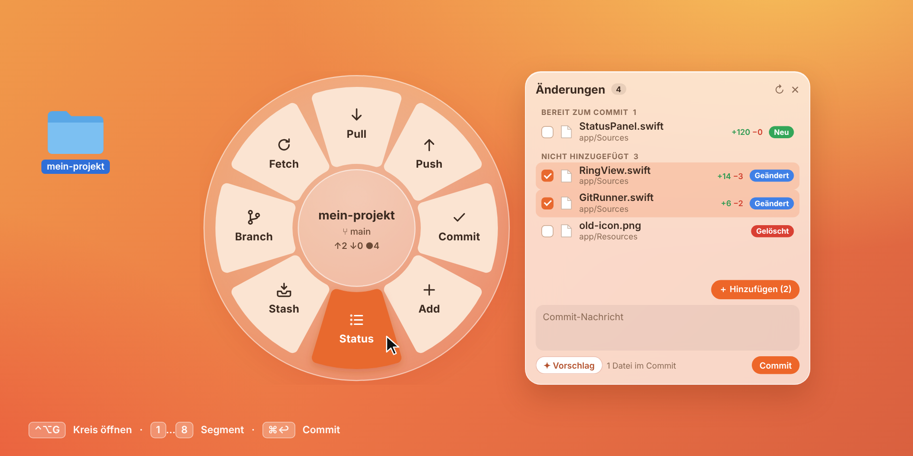
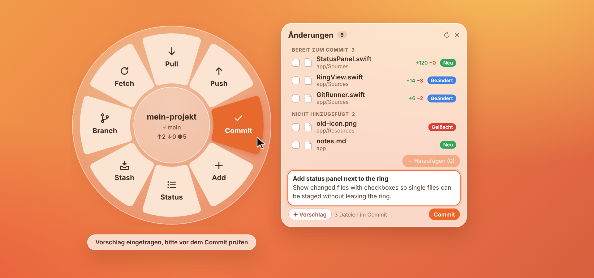
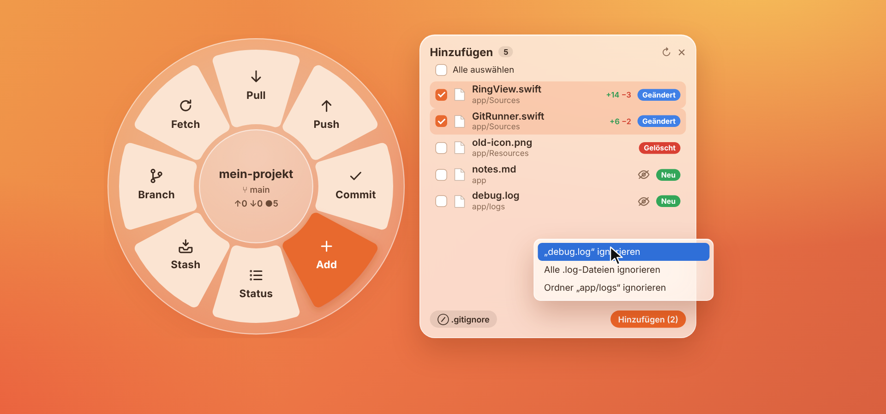
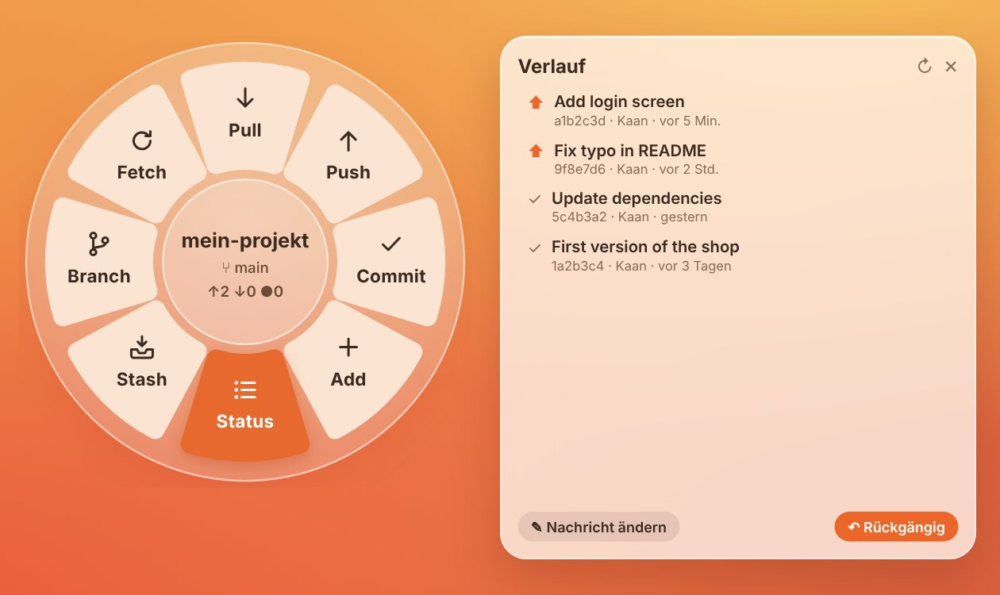
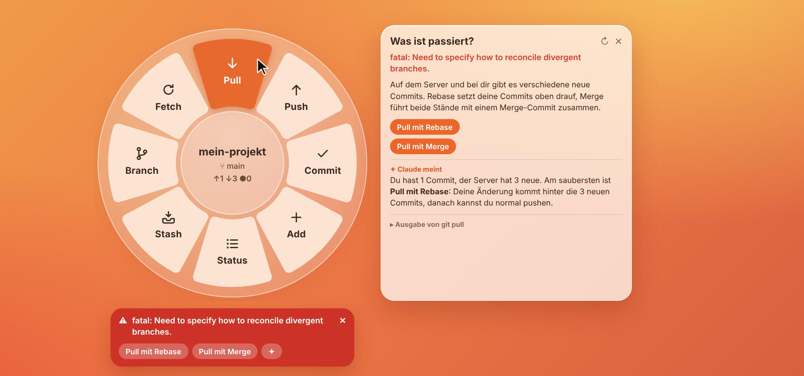

<p align="center">
  
</p>

<h1 align="center">Ringit</h1>

<p align="center">
  Ein kleiner Git-Kreis für macOS. Ordner auswählen, <kbd>⌃</kbd><kbd>⌥</kbd><kbd>G</kbd> drücken, dann Pull, Add, Commit und Push.<br>
  <a href="README.md">English</a> · <a href="#installieren">Installieren</a> · <a href="#der-kreis">Der Kreis</a> · <a href="#faq">FAQ</a>
</p>

<p align="center">
  <a href="https://github.com/452kaan/ringit/releases/latest/download/Ringit.dmg"><b>Ringit.dmg herunterladen</b></a>
</p>

<p align="center">
  
</p>

---

Ich wollte etwas zwischen Terminal und großem Git-Programm. Meistens brauche ich nur ein
paar Sachen: Pull, schauen was sich geändert hat, ein paar Dateien hinzufügen, Commit-Nachricht
schreiben, Push. Dafür ein großes Programm zu öffnen ist mir zu viel, und alles im Terminal
zu tippen nervt auf Dauer.

Ringit sitzt in der Menüleiste. Ordner im Finder auswählen, <kbd>⌃</kbd><kbd>⌥</kbd><kbd>G</kbd>
drücken, und direkt an der Maus geht ein Kreis mit den üblichen Git-Befehlen auf. Einen
anklicken (oder die Zahl drücken), fertig. <kbd>Esc</kbd> oder ein Klick daneben, und er ist weg.

## Installieren

Du brauchst macOS 12 Monterey oder neuer (Apple Silicon oder Intel) und Git. Fehlt Git,
sagt dir das die Einrichtung und installiert die Xcode Command Line Tools mit einem Klick.

1. [**Ringit.dmg**](https://github.com/452kaan/ringit/releases/latest/download/Ringit.dmg)
   herunterladen (alle Versionen stehen unter [Releases](https://github.com/452kaan/ringit/releases)).
2. Öffnen und **Ringit** in **Programme** ziehen. Startest du es von woanders, bietet
   Ringit an, sich selbst dorthin zu verschieben.
3. Ringit ist nicht von Apple beglaubigt, deshalb blockt macOS den ersten Start. Auf macOS 12
   bis 14: **Rechtsklick auf Ringit → Öffnen** und bestätigen. Ab macOS 15: einmal öffnen,
   dann Systemeinstellungen → Datenschutz & Sicherheit → **Dennoch öffnen**.
   Danach startet es ganz normal.

**Mit Homebrew:**

```sh
brew tap 452kaan/ringit https://github.com/452kaan/ringit
brew install --cask ringit
```

Ringit schaut außerdem einmal am Tag, ob es eine neue Version gibt, und sagt es dir im Menü.
Nach einem Update zeigt es dir einmal, dass die neue Version installiert ist.

Beim ersten Start führt dich eine kurze Einrichtung durch alles: Sprache, Tastenkürzel, Git,
Finder-Zugriff, Start beim Anmelden und (freiwillig) Claude. Du kannst sie überspringen und
jederzeit über **Einstellungen → Einrichtung …** im Menü wieder öffnen.

Am Ende kannst du dir eine kurze **Anleitung** mit Bildern ansehen, ein Thema pro Seite.
Die findest du auch später jederzeit im Menü unter **Anleitung …**.

## Kreis öffnen

<kbd>⌃</kbd><kbd>⌥</kbd><kbd>G</kbd> drücken. Gefällt dir nicht? In der Einrichtung oder
unter **Einstellungen → Tastenkürzel ändern …** im Menü nimmst du dein eigenes auf.

Der Kreis geht für das auf, was im Finder ausgewählt ist: den ausgewählten Ordner, den Ordner
einer ausgewählten Datei oder den Ordner des vorderen Finder-Fensters. Ist der Finder nicht
vorne, nimmt Ringit den zuletzt benutzten Ordner. Über **Ordner öffnen …** im Menü geht es auch,
oder du ziehst einen Ordner direkt auf den Kreis.

macOS fragt einmal, ob Ringit die Auswahl im Finder lesen darf. Wenn du Nein gesagt hast,
geht der Kreis auf dem zuletzt benutzten Ordner auf, und im Menü steht **Finder-Zugriff erlauben …**.

**Kreis verschieben:** Mitte festhalten und ziehen. Ein Klick auf die Mitte neben den Namen
geht einen Ordner nach oben (bis zum Hauptordner des Repos).

**Ordner wechseln:** Klick auf den Namen in der Mitte (oder Rechtsklick auf die Mitte) zeigt
die zuletzt benutzten Repos, so wechselst du ohne Umweg über den Finder. Fährst du über ein
Repo, klappen daneben die Unterordner auf, die du darin zuletzt benutzt hast. Ein Rechtsklick
auf einen Eintrag öffnet den Ordner im Finder.

## Der Kreis

Acht Segmente, im Uhrzeigersinn ab oben. Die Tasten <kbd>1</kbd>–<kbd>8</kbd> lösen sie in
dieser Reihenfolge aus.

| | | |
|---|---|---|
| 1 | **Pull** | Holt den aktuellen Branch und sagt dir, wie viele Commits neu sind. |
| 2 | **Push** | Pusht den aktuellen Branch. Ist er noch nicht auf dem Server, pusht Ringit ihn nach `origin` und verknüpft ihn. |
| 3 | **Commit** | Öffnet die Statusleiste mit dem Cursor im Commit-Feld. |
| 4 | **Add** | Öffnet eine Leiste, in der du auswählst, welche Dateien in den Commit kommen. |
| 5 | **Status** | Zeigt neben dem Kreis, was sich geändert hat. |
| 6 | **Stash** | Änderungen parken und später zurückholen. |
| 7 | **Branch** | Zu einem anderen Branch wechseln oder einen neuen anlegen. |
| 8 | **Fetch** | Schaut auf dem Server nach neuen Commits, ohne deine Dateien anzufassen. |

In der Mitte stehen der Name des Repos (und der Unterordner, falls du einen geöffnet hast),
der Branch und wie viele Dateien geändert sind ●. Sobald der Branch auf dem Server ist,
siehst du auch, wie viele Commits du voraus ↑ und hinterher ↓ bist. Alle Leisten gehen
direkt neben dem Kreis auf, es gibt keine extra Fenster.

**Auto-Fetch:** Rechtsklick auf **Fetch** und wählen, wie oft Ringit dieses Projekt im
Hintergrund fetcht: alle 5, 15 oder 30 Minuten, stündlich oder täglich. Das gilt
nur für dieses eine Projekt, Standard ist aus. Ringit fetcht nur und pullt nie. Gibt es
Neues auf dem Server, bekommt das Menüleisten-Symbol einen Punkt, das Menü zeigt oben, wo,
und du bekommst eine Mitteilung (abschaltbar unter **Einstellungen → Auto-Fetch**).

<p align="center">
  
</p>

## Status und Commit

<p align="center">
  
</p>

Die Statusleiste zeigt deine Änderungen in drei Gruppen: **Konflikte**, **Bereit zum Commit**
und **Nicht hinzugefügt**. Zu jeder Datei siehst du Name, Ordner, ein farbiges Etikett
(Geändert, Neu, Gelöscht, Umbenannt, Konflikt) und wie viele Zeilen dazugekommen und
weggefallen sind.

- Dateien anhaken und **Hinzufügen (n)** drücken. Oder Dateien unter *Bereit zum Commit*
  anhaken und mit **Entfernen (n)** wieder aus dem Commit nehmen. Deine Änderungen bleiben dabei erhalten.
- Mit der Maus über eine Datei und aufs Auge klicken (oder auf die +/−-Zahlen) zeigt ihre
  Änderungen, grün was dazukam, rot was wegfiel.
- Doppelklick öffnet eine Datei. Rechtsklick für *Änderungen anzeigen*, *Im Finder zeigen*,
  *Pfad kopieren* und *Änderungen verwerfen …*. Das fragt vorher nach und legt den aktuellen Stand in den Papierkorb.
- Unten die Nachricht eintippen und **Commit** oder <kbd>⌘</kbd><kbd>↩</kbd> drücken.

**Unterordner gehen.** Öffnest du den Kreis auf `mein-repo/app/`, siehst du nur, was sich
unterhalb von `app/` geändert hat. **Repos in Repos** (verschachtelte Repos, Submodule)
stehen ganz unten, ein Klick öffnet den Kreis darauf.

## Add und .gitignore

<p align="center">
  
</p>

**Add** fügt nicht einfach alles hinzu. Es öffnet eine Liste aller Dateien, die noch nicht
im Commit sind. Anhaken, was du willst (oder **Alle auswählen**), und **Hinzufügen (n)** drücken.

Neue Dateien, die nie in einen Commit sollen, haben ein Augen-Symbol. Darüber ignorierst du
nur diese Datei, alle Dateien mit dieser Endung oder den ganzen Ordner. Ringit schreibt die
Regel in die `.gitignore`, und die Dateien verschwinden aus der Liste. Der Knopf **.gitignore**
unten zeigt die Datei, dort kannst du sie auch selbst bearbeiten.

## Commit-Nachrichten von Claude

Neben dem Commit-Feld auf **✦ Vorschlag** drücken, und Claude schreibt eine Nachricht für die
Dateien im Commit. Durchlesen, ändern was du willst, dann selbst auf **Commit** drücken.

- In der Einrichtung oder unter **Einstellungen → Sprache der Commit-Vorschläge** wählst du **Englisch** oder **Deutsch**. Standard ist Englisch.
- **Keine `Co-Authored-By`-Zeile.** Der Commit gehört dir. Ringit entfernt solche Zeilen auch,
  falls Claude doch eine schreibt.
- **Ohne dich wird nichts committet.**

**Was an Claude geht:** der Branch-Name, deine letzten 8 Commit-Betreffzeilen, die Liste der
Dateien im Commit und ihr Diff. Lockfiles und minifizierte Dateien bleiben draußen, sehr
große Diffs werden gekürzt. Private Dateien verlassen nie deinen Mac, nicht mal ihr Name:
`.env`, `.env.*`, `*.pem`, `*.key`, `*.p8`, `*.p12`, `*.pfx`, `*.ppk`, `*.keystore`, `*.jks`,
SSH-Schlüssel, `*.tfvars`, `.pgpass`, `.npmrc`, `.netrc`, alles mit `secret` oder `credential`
im Namen und alles in einem Ordner `secrets/` oder `credentials/`. Ein Passwort in einer
normalen Datei wie `config.yml` geht mit, das gehört also nicht in den Commit.

**Wie Ringit mit Claude redet:** über [Claude Code](https://docs.anthropic.com/en/docs/claude-code)
auf deinem Mac, mit deinem eigenen Claude-Abo. Die Einrichtung installiert es auf Wunsch und
sorgt dafür, dass der Befehl `claude` gefunden wird. Willst du Claude Code nicht nutzen, kannst
du im Menü unter **Einstellungen → Claude → API-Schlüssel hinterlegen …** einen Anthropic-API-Schlüssel
eintragen. Der liegt dann in deinem Schlüsselbund. Claude ist komplett freiwillig, alles
andere geht auch ohne.

## Branches und Stash

**Branch** zeigt deine Branches, die neuesten oben. Ein Klick wechselt. Im Feld kannst du
suchen oder einen neuen Namen tippen und mit **Anlegen** einen Branch erstellen und gleich
hinwechseln. Branches, die es nur auf dem Server gibt, stehen extra. Ein Klick holt sie dir lokal.

**Stash** parkt alle Änderungen, auch neue Dateien, auf Wunsch mit Notiz. Dein Ordner ist
danach sauber. **Zurückholen** bringt sie wieder. Rechtsklick auf einen Eintrag für
*Anwenden und behalten* oder *Löschen …*.

## Verlauf, GitHub und GitLab

<p align="center">
  
</p>

**Verlauf** (die Uhr oben im Status oder Rechtsklick auf die Mitte) zeigt deine letzten
Commits. Ein Pfeil markiert die, die noch nicht gepusht sind. Solange der neueste Commit nur
auf deinem Mac liegt, kannst du ihn **rückgängig** machen (die Änderungen bleiben vorgemerkt)
oder die **Nachricht ändern**.

**Auf GitHub, GitLab oder Bitbucket:** Rechtsklick auf die Mitte für *Auf GitHub öffnen* und
*Pull Request erstellen* (bei GitLab *Merge Request*). Nach dem ersten Push eines neuen
Branches bietet die Meldung unter dem Kreis denselben Link an.

## Wenn etwas schiefgeht

<p align="center">
  
</p>

Schlägt ein Git-Befehl fehl, erscheint unter dem Kreis eine rote Karte mit der Meldung von
Git und den Lösungen, die du wahrscheinlich sowieso probieren würdest. Ein Klick auf die
Meldung erklärt sie in normalen Worten.

| Was passiert ist | Lösungen auf der Karte |
|---|---|
| Du und der Server habt verschiedene neue Commits | Pull mit Rebase · Pull mit Merge |
| Push abgelehnt, der Server hat neue Commits | Erst Pull, dann Push |
| Lokale Änderungen würden überschrieben | Parken, Pull, zurücklegen · Parken und wechseln |
| Branch ist noch nicht auf dem Server | Branch zum Server pushen |
| Merge-Konflikt | Konflikte zeigen · Abbrechen |
| Git kennt deinen Namen und deine E-Mail nicht | Name und E-Mail eintragen |
| Ein anderer Git-Prozess hat eine Sperre liegen lassen | Sperre entfernen |

**✦ Claude fragen** erklärt den Fehler und schlägt vor, was zu tun ist. An Claude gehen nur
die Meldung von Git und ein kurzer Status, keine Dateiinhalte. Claude schlägt nur vor und
führt nie selbst etwas aus.

Läuft ein Merge oder Rebase mit Konflikten, zeigt die Statusleiste einen orangen Balken.
Dateien reparieren, jede mit dem Häkchen als gelöst markieren, dann **Fortsetzen** (Rebase)
oder committen (Merge). **Abbrechen** stellt den Stand von vorher wieder her.

## Das Menü

Alles steckt im Symbol in der Menüleiste, ein Einstellungsfenster gibt es nicht:

- **Ordner öffnen …** (<kbd>⌘</kbd><kbd>O</kbd>)
- **Zuletzt benutzt**: die letzten drei Git-Ordner, ältere unter **Weitere anzeigen**, dazu **Verlauf leeren**.
  Über einem Repo klappen die zuletzt benutzten Unterordner auf, Rechtsklick öffnet einen Eintrag im Finder
- **Einstellungen**:
  - **Claude**: ob Claude Code installiert und angemeldet ist, und der freiwillige API-Schlüssel
  - **Sprache der Commit-Vorschläge**: Englisch oder Deutsch
  - **Auto-Fetch**: alle Projekte, die im Hintergrund gefetcht werden, zum Ändern oder Abschalten,
    und ob du bei neuen Commits eine Mitteilung bekommst
  - **Beim Anmelden starten**
  - **Sprache**: wie macOS, oder Deutsch bzw. Englisch
  - **Tastenkürzel ändern …**, **Einrichtung …** und **Nach Updates suchen …**
- **Anleitung …**: alle Funktionen nach Themen
- **Ringit beenden**

## Tastenkürzel

| | |
|---|---|
| <kbd>⌃</kbd> <kbd>⌥</kbd> <kbd>G</kbd> (oder dein eigenes) | Kreis für den Ordner im Finder öffnen oder schließen |
| <kbd>1</kbd> … <kbd>8</kbd> | Segment auslösen |
| <kbd>⌘</kbd> <kbd>↩</kbd> | Commit |
| <kbd>Esc</kbd> | Erst die offene Rückfrage, dann die Leiste, dann den Kreis schließen |
| Klick auf die Mitte | Einen Ordner nach oben |
| Klick auf den Namen in der Mitte | Zu einem zuletzt benutzten Ordner wechseln |
| Mitte festhalten und ziehen | Kreis verschieben |

## FAQ

**Ersetzt Ringit das Terminal?**
Nein. Es deckt den Alltag ab. Interaktives Rebase, Bisect und so weiter machst du weiter im Terminal.

**Geht das mit Git LFS, Submodulen oder mehreren Remotes?**
Ringit ruft dein installiertes `git` auf, LFS und Submodule verhalten sich also wie im
Terminal. Es gibt keine Passwortabfrage. HTTPS-Logins müssen deshalb aus einem Credential
Helper wie dem macOS-Schlüsselbund kommen, SSH-Schlüssel aus dem Schlüsselbund oder dem
ssh-agent. Bei mehreren Remotes geht der erste Push eines neuen Branches nach `origin`.

**macOS sagt, die App sei beschädigt oder von einem nicht verifizierten Entwickler.**
Das liegt daran, dass sie nicht von Apple beglaubigt ist, siehe Schritt 3 unter
[Installieren](#installieren). Sagt macOS weiter „beschädigt“, einmal
`xattr -dr com.apple.quarantine /Applications/Ringit.app` im Terminal ausführen.

**Mein Tastenkürzel tut nichts.**
Vielleicht benutzt ein anderes Programm es schon. Dann nimmt Ringit wieder
<kbd>⌃</kbd><kbd>⌥</kbd><kbd>G</kbd>. Unter **Einstellungen → Tastenkürzel ändern …** ein anderes wählen.

**Nach dem Update geht noch die alte Version auf.**
Einfach die neue starten. Sie beendet die alte von selbst.

## Lizenz

[MIT](LICENSE)
