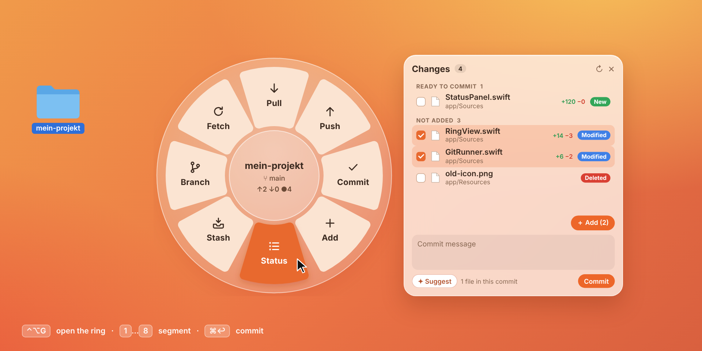
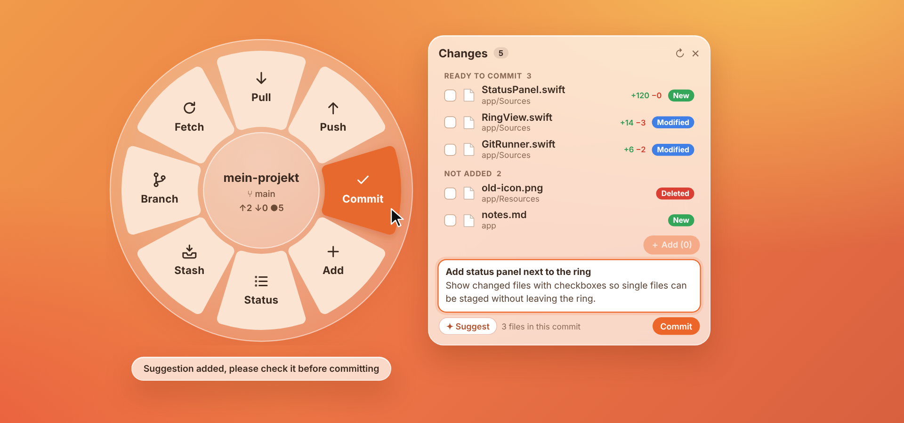
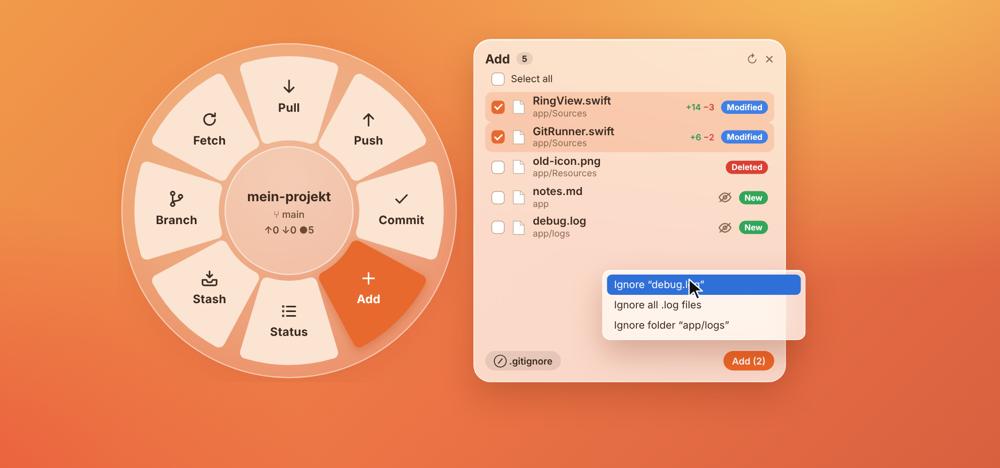
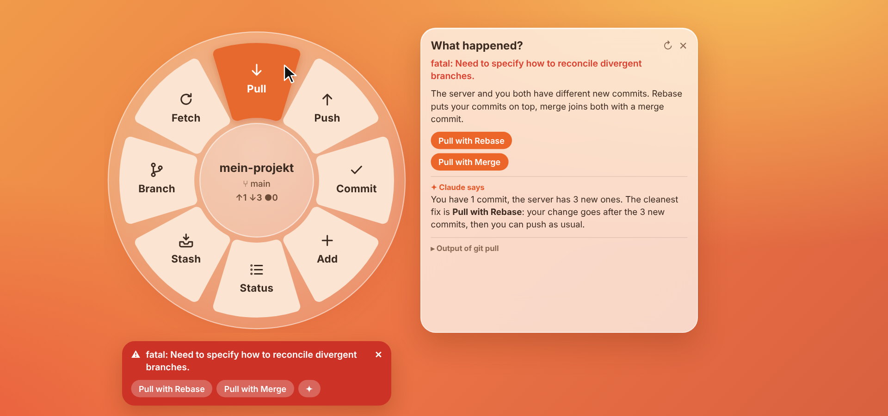

  

<h1 align="center">Ringit</h1>

  A tiny Git ring for macOS. Select a folder, press <kbd>⌃</kbd><kbd>⌥</kbd><kbd>G</kbd>, then pull, add, commit and push. 
  <a href="README.de.md">Deutsch</a> · <a href="#install">Install</a> · <a href="#the-ring">The ring</a> · <a href="#faq">FAQ</a>

  <a href="https://github.com/452kaan/ringit/releases/latest/download/Ringit.dmg"><b>Download Ringit.dmg</b></a>

  

---

I wanted something between the terminal and a full Git client. Most days I only need a
handful of things: pull, see what changed, add a few files, write a commit message, push.
Opening a big app for that feels heavy, and typing it all out in the terminal gets old.

Ringit lives in the menu bar. Select a folder in Finder, press <kbd>⌃</kbd><kbd>⌥</kbd><kbd>G</kbd>,
and a ring pops up right at your cursor with the common Git actions. Click one (or press its
number), done. <kbd>Esc</kbd> or a click somewhere else and it's gone.

## Install

You need macOS 12 Monterey or newer (Apple Silicon or Intel) and Git. If Git is missing,
the setup tells you and installs the Xcode Command Line Tools with one click.

1. Download [**Ringit.dmg**](https://github.com/452kaan/ringit/releases/latest/download/Ringit.dmg)
   (all versions are under [Releases](https://github.com/452kaan/ringit/releases)).
2. Open it and drag **Ringit** into **Applications**. If you start it from somewhere else,
   Ringit offers to move itself there.
3. Ringit isn't notarized by Apple, so macOS blocks the first launch. On macOS 12 to 14:
   **right-click Ringit → Open**, then confirm. On macOS 15 and newer: try to open it once,
   then go to System Settings → Privacy & Security and click **Open Anyway**.
   After that it opens normally.

On first launch a short setup walks you through everything: language, your shortcut, Git,
Finder access, launch at login and (optional) Claude. You can skip it and bring it back any
time from the menu with **Setup…**.

## Opening the ring

Press <kbd>⌃</kbd><kbd>⌥</kbd><kbd>G</kbd>. Don't like it? Record your own shortcut in the
setup or under **Change Shortcut…** in the menu.

The ring opens for whatever is selected in Finder: the selected folder, the folder of a
selected file, or the folder of the front Finder window. If Finder isn't in front, you get
the folder you used last. You can also pick one with **Open Folder…** in the menu.

macOS asks once whether Ringit may read the Finder selection. If you said no, the ring
opens on the folder you used last, and the menu shows **Allow Finder Access…**.

**Moving the ring:** hold the center and drag. A plain click on the center goes up one
folder (as far as the repo's top folder).

## The ring

Eight segments, clockwise from the top. Keys <kbd>1</kbd>–<kbd>8</kbd> trigger them in that order.

| | | |
|---|---|---|
| 1 | **Pull** | Pulls the current branch and tells you how many commits came in. |
| 2 | **Push** | Pushes the current branch. If it isn't on the server yet, Ringit pushes it to `origin` and links it. |
| 3 | **Commit** | Opens the status panel with the cursor in the commit field. |
| 4 | **Add** | Opens a panel where you pick which files go into the commit. |
| 5 | **Status** | Shows what changed, next to the ring. |
| 6 | **Stash** | Put your changes aside and get them back later. |
| 7 | **Branch** | Switch to another branch or create a new one. |
| 8 | **Fetch** | Checks the server for new commits without touching your files. |

The center shows the repo name (plus the subfolder if you opened one), the branch, and how
many files changed ●. Once the branch is on the server you also see commits ahead ↑ and
behind ↓. All panels open right next to the ring, no extra windows.

## Status and commit

  

The status panel lists your changes in three groups: **Conflicts**, **Ready to commit** and
**Not added**. Each file shows its name, its folder, a colored tag (Modified, New, Deleted,
Renamed, Conflict) and how many lines were added and removed.

- Tick files and press **Add (n)**, or tick files under *Ready to commit* and press
  **Remove (n)** to take them out of the commit again. Your changes stay as they are.
- Double-click a file to open it. Right-click for *Show in Finder*, *Copy path* and
  *Discard changes…*, which asks first and moves the current version to the Trash.
- Type a message at the bottom and press **Commit** or <kbd>⌘</kbd><kbd>↩</kbd>.

**Subfolders work.** Open the ring on `my-repo/app/` and you only see what changed below
`app/`. **Repos inside repos** (nested repos, submodules) are listed at the bottom; click
one to open the ring on it.

## Add and .gitignore

  

**Add** doesn't just stage everything. It opens a list of all files that aren't in the commit
yet. Tick what you want (or **Select all**) and press **Add (n)**.

New files you never want to commit get an eye icon. Click it to ignore just that file, all
files with that extension, or the whole folder. Ringit writes the rule into `.gitignore` and
the files disappear from the list. The **.gitignore** button at the bottom shows the file so
you can edit it by hand.

## Commit messages from Claude

Press **✦ Suggest** next to the commit field and Claude writes a message for the files in
the commit. Read it, change what you like, then press **Commit** yourself.

- Pick **English** or **German** under **Commit suggestion language** in the menu. English is the default.
- **No `Co-Authored-By` line.** The commit is yours. Ringit also strips such lines if
  Claude adds one anyway.
- **Nothing gets committed without you.**

**What gets sent:** the branch name, your last 8 commit subjects, the list of files in the
commit and their diff. Lockfiles and minified files stay out, and very large diffs get cut
down. Private files never leave your Mac, not even their names: `.env`, `.env.*`, `*.pem`,
`*.key`, `*.p8`, `*.p12`, `*.pfx`, `*.ppk`, `*.keystore`, `*.jks`, SSH keys, `*.tfvars`,
`.pgpass`, `.npmrc`, `.netrc`, anything with `secret` or `credential` in its name, and
everything inside a `secrets/` or `credentials/` folder. A password in an ordinary file like
`config.yml` does get sent, so keep that out of the commit.

**How it talks to Claude:** through [Claude Code](https://docs.anthropic.com/en/docs/claude-code)
on your Mac, with your own Claude subscription. The setup installs it for you if you want and
makes sure the `claude` command is found. If you'd rather not use Claude Code, add an
Anthropic API key under **Claude → Add API Key…** in the menu. It's stored in your keychain.
Claude is completely optional; everything else works without it.

## Branches and stash

**Branch** shows your branches, newest first. Click one to switch. Type in the field to
search, or type a new name and press **Create** to make a branch and switch to it right
away. Branches that only exist on the server are listed separately; clicking one checks it
out locally.

**Stash** puts all your changes aside, including new files, with an optional note. Your
folder is clean afterwards. **Restore** brings them back. Right-click an entry for
*Apply and Keep* or *Delete…*.

## When something goes wrong

  

If a Git command fails, a red card shows up under the ring with Git's message and the fixes
you'd probably try anyway. Click the message for an explanation in plain words.

| What happened | Fixes on the card |
|---|---|
| Server and you both have new commits | Pull with Rebase · Pull with Merge |
| Push rejected, the server has new commits | Pull, Then Push |
| Local changes would be overwritten | Stash, Pull, Restore · Stash and Switch |
| Branch isn't on the server yet | Push Branch to Server |
| Merge conflict | Show Conflicts · Abort |
| Git doesn't know your name and email | Set Name and Email |
| Another Git process left a lock behind | Remove Lock |

**✦ Ask Claude** explains the error and suggests what to do. Only Git's message and a short
status go to Claude, no file contents. It only suggests, it never runs anything on its own.

During a merge or rebase with conflicts, the status panel shows an orange bar. Fix the files,
mark each one as resolved with the checkmark, then **Continue** (rebase) or commit (merge).
**Abort** goes back to how things were before.

## The menu

Everything you can set lives in the menu bar icon, there's no settings window:

- **Open Folder…** (<kbd>⌘</kbd><kbd>O</kbd>) and your recent folders
- **Claude**: whether Claude Code is installed and signed in, and the optional API key
- **Launch at Login**
- **Language**: follows macOS, or pick English or German
- **Commit suggestion language**: English or German
- **Change Shortcut…** and **Setup…**

## Shortcuts

| | |
|---|---|
| <kbd>⌃</kbd> <kbd>⌥</kbd> <kbd>G</kbd> (or your own) | Open or close the ring for the folder selected in Finder |
| <kbd>1</kbd> … <kbd>8</kbd> | Run a segment |
| <kbd>⌘</kbd> <kbd>↩</kbd> | Commit |
| <kbd>Esc</kbd> | Close the open question, then the panel, then the ring |
| Click the center | Go up one folder |
| Hold and drag the center | Move the ring |

## FAQ

**Does Ringit replace the terminal?**
No. It covers the everyday stuff. Interactive rebases, bisecting and so on still happen in
the terminal.

**Does it work with Git LFS, submodules or several remotes?**
Ringit calls the `git` you have installed, so LFS and submodules work like in your terminal.
There's no password prompt, so HTTPS logins have to come from a credential helper like the
macOS keychain, and SSH keys from the keychain or ssh-agent. With several remotes, the first
push of a new branch goes to `origin`.

**macOS says the app is damaged or from an unidentified developer.**
That's because it isn't notarized, see step 3 under [Install](#install). If macOS still calls
it damaged, run `xattr -dr com.apple.quarantine /Applications/Ringit.app` once.

**My shortcut does nothing.**
Another app may already use it. In that case Ringit falls back to <kbd>⌃</kbd><kbd>⌥</kbd><kbd>G</kbd>.
Pick a different one under **Change Shortcut…**.

**I updated and the old version still opens.**
Just start the new one. It quits the old copy by itself.

## License

[MIT](LICENSE)
